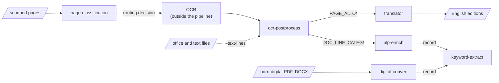

# ATRIUM — ÚFAL documentation

The Institute of Formal and Applied Linguistics (ÚFAL, Charles University) builds six tools for
**ATRIUM**. Together they take archival documents, such as typewritten reports, handwritten field notes,
photographs, drawings and born-digital files, and turn them into structured, searchable records. This
site explains what each tool does and how they fit together.

## What ATRIUM is

**ATRIUM** (*Advancing fronTier Research In the arts and hUManities*) is an EU project. It connects four
European research infrastructures: **DARIAH** (arts and humanities), **ARIADNE** (archaeology),
**CLARIN** (language technologies) and **OPERAS** (open scholarly communication). More at
[atrium-research.eu](https://atrium-research.eu/), and in the
[project presentation on Zenodo](https://zenodo.org/records/19500212).

This site documents ÚFAL's part: six tool repositories and the hub that holds them together, seven
repositories in all.

## Start here

Find the line that describes you:

| You are                              | Start with                                | Then                                                                                                                        |
|--------------------------------------|-------------------------------------------|-----------------------------------------------------------------------------------------------------------------------------|
| archive or collection staff          | [For archives](for-archives.md)           | [Licences and paradata](ecosystem/licences.md) · [Glossary](glossary.md)                                                    |
| running the services                 | [Operations](operations.md)               | [S2 pilot handover](pilot.md), which links each service's runbook                                                           |
| calling a tool from your own code    | [Workflows](workflows/index.md)           | [The document contract](ecosystem/document-contract.md) · [Schemas](contracts/schemas.md) · [Agent skills](agent-skills.md) |
| developing the tools                 | [Architecture](ecosystem/architecture.md) | [Contributing standards](contributing-standards.md) · [Development history](development-history.md)                         |
| managing or coordinating the project | [Status](status.md)                       | [S2 pilot handover](pilot.md) · [Repository map](ecosystem/repository-map.md)                                               |
| judging the methods and results      | [Pipelines](pipelines.md)                 | each tool's evaluation pages, from the documentation map in its README                                                      |

Or by question:

| If you want to…                                                     | Read                                                                                            |
|---------------------------------------------------------------------|-------------------------------------------------------------------------------------------------|
| look up an unfamiliar word                                          | [Glossary](glossary.md)                                                                         |
| see what each tool does, step by step                               | [Workflows](workflows/index.md)                                                                 |
| see what passes from one tool to the next                           | [Pipelines](pipelines.md)                                                                       |
| know what a record written by these tools looks like                | [The document contract](ecosystem/document-contract.md)                                         |
| run a tool as a service, or on Kubernetes                           | [Operations](operations.md)                                                                     |
| let a coding agent use a tool                                       | [Agent skills](agent-skills.md)                                                                 |
| know what every field and label means                               | [Schemas](contracts/schemas.md) · [SKOS & the ATRIUM vocabulary](contracts/skos.md)             |
| publish results to a repository or catalogue                        | [RO-Crate export](contracts/rocrate.md)                                                         |
| describe a tool's workflow on the SSH Open Marketplace or in Galaxy | [Workflows](workflows/index.md)                                                                 |
| read about a standard, model or service the tools use               | [External tools & services](external-tools.md)                                                  |
| find which repository owns what                                     | [Repository map](ecosystem/repository-map.md)                                                   |
| change shared code, or contribute                                   | [Architecture](ecosystem/architecture.md) · [Contributing standards](contributing-standards.md) |

## The seven repositories

-   **page-classification**

    ---

    Sorts each scanned page into one of **eleven page types**. A person or a script then decides
    whether the page needs OCR, handwriting recognition, table extraction or image handling.

    [Workflow](workflows/page-classification.md) · [Documentation](https://github.com/ufal/atrium-page-classification/blob/test/README.md#documentation) · [Landing page](https://ufal.github.io/atrium-page-classification/) · [Source](https://github.com/ufal/atrium-page-classification)

-   **ocr-postprocess**

    ---

    Checks OCR output line by line. Every line gets its language and a quality label, so you know
    which lines to use, correct or send to OCR again. It reads ALTO and the other common OCR formats,
    and PDF, office and text files.

    [Workflow](workflows/ocr-postprocess.md) · [Documentation](https://github.com/ufal/atrium-ocr-postprocess/blob/test/README.md#documentation) · [Landing page](https://ufal.github.io/atrium-ocr-postprocess/) · [Source](https://github.com/ufal/atrium-ocr-postprocess)

-   **translator**

    ---

    Translates ALTO pages and AMČR metadata records **in place**. Every tag, namespace and coordinate
    stays; only the text changes.

    [Workflow](workflows/translator.md) · [Documentation](https://github.com/ufal/atrium-translator/blob/test/README.md#documentation) · [Landing page](https://ufal.github.io/atrium-translator/) · [Source](https://github.com/ufal/atrium-translator)

-   **nlp-enrich**

    ---

    Adds each word's base form, part of speech and grammar, and the names of people, places and
    organisations, using LINDAT's UDPipe and NameTag. The result is a TEITOK file that keeps every
    word's place on the page.

    [Workflow](workflows/nlp-enrich.md) · [Documentation](https://github.com/ufal/atrium-nlp-enrich/blob/test/README.md#documentation) · [Landing page](https://ufal.github.io/atrium-nlp-enrich/) · [Source](https://github.com/ufal/atrium-nlp-enrich)

-   **keyword-extract**

    ---

    Gives documents two kinds of keyword: statistical ones taken from the text, and terms from AMČR's
    keyword lists and the TEATER thesaurus, chosen by a language model.

    [Workflow](workflows/keyword-extract.md) · [Documentation](https://github.com/ufal/atrium-keyword-extract/blob/test/README.md#documentation) · [Landing page](https://ufal.github.io/atrium-keyword-extract/) · [Source](https://github.com/ufal/atrium-keyword-extract)

-   **digital-convert**

    ---

    Reads born-digital files (PDF, DOCX, ODT, ODS, XLSX, RTF; DOC and XLS through LibreOffice) into the
    document record, without OCR. Pages whose text cannot be read are marked, so only those go to OCR.

    [Workflow](workflows/digital-convert.md) · [Documentation](https://github.com/ufal/atrium-digital-convert/blob/test/README.md#documentation) · [Landing page](https://ufal.github.io/atrium-digital-convert/) · [Source](https://github.com/ufal/atrium-digital-convert)

-   **atrium-project**, the hub

    ---

    The code every tool shares, the checks they all run, the end-to-end tests, and this site.

    [Architecture](ecosystem/architecture.md) · [Repository map](ecosystem/repository-map.md)

## How the tools work together

**Six tools, each in its own repository.** Each tool is a command-line program and an HTTP service built
from the same code. Each ships as container images. The tools need very different environments: a
vision-model stack, CPU rules, remote translation services, GPU language models. So they are not
combined into one program.

**One record per document.** A JSON file, `<doc_id>.document.json`, ties the stages together. Each stage
reads it, adds the one block it owns, and passes it on. By the end it holds the page categories, the
text, the translation reference, the entities and the keywords. It also records which program, at which
version and with which components, wrote each part. See [The document contract](ecosystem/document-contract.md).

**One hub.** `atrium-project` holds the code every tool shares: the record, the paradata, the licence
rules, the vocabulary and the service contract. It hands out identical copies of that code, runs the
checks every tool calls, and runs the end-to-end test of all the tools together. See
[Architecture](ecosystem/architecture.md).

**Built here, run by the partners.** ÚFAL builds, tests and publishes the container images. The partner
institutes of archaeology run them on their own infrastructure, next to their own collections. See
[Operations](operations.md).

## About this site

Every page here is **written**, not generated. It explains how the parts fit together, and ends with a
*Sources* table naming what it was written from. Each tool's own documentation, its README and its
`docs/` pages, holds the details; these pages connect them.

The site's source is `docs_site/` in the hub. A pull request builds it with `mkdocs build --strict`,
which fails on any broken link or anchor between pages. A merge to `main` publishes it to the
`gh-pages` branch.
