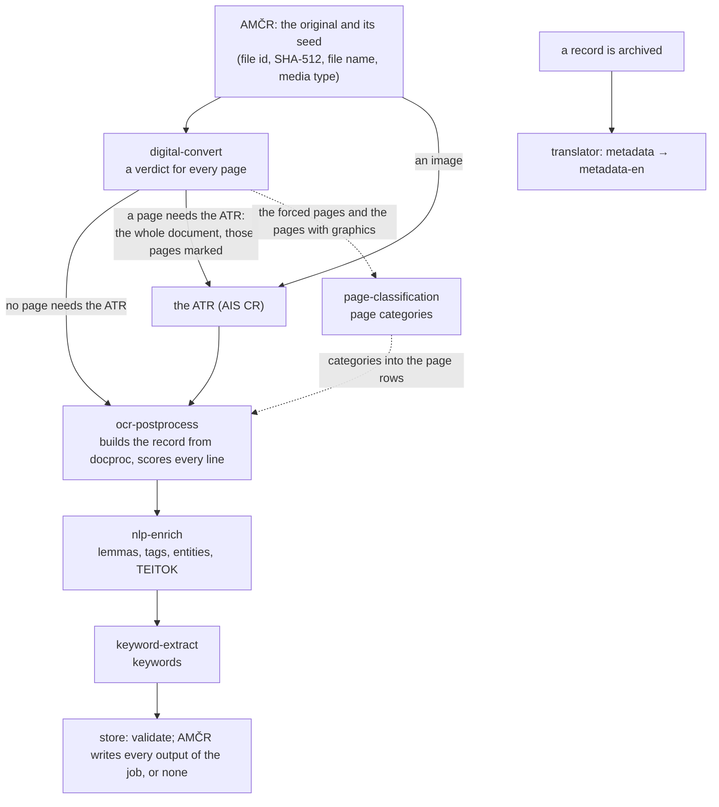
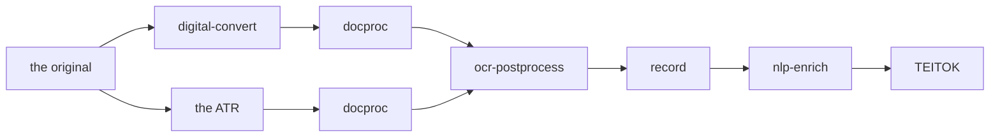

# Pipelines

This page says how the tools work together: the route a document takes in the AMČR pilot, what each
step reads and writes, and the other workflows the tools take part in. It is for developers and
evaluators. Each tool's **own** workflow, told step by step for one tool at a time, is on
[Workflows](workflows/index.md).

**The workflows at a glance:**

| #   | Workflow                                                                         | In one line                                                                        |
|-----|----------------------------------------------------------------------------------|------------------------------------------------------------------------------------|
| —   | [The route through the pipeline](#the-route-through-the-pipeline)                | an AMČR file in; its layout, record, linguistic layer and keywords out, or nothing |
| W1  | [Scanned / OCR document pipeline](#w1--scanned--ocr-document-pipeline)           | the route of a document whose pages need text recognition                          |
| W2  | [Born-digital pipeline](#other-workflows)                                        | the route of a document whose text is already in the file                          |
| W3  | [Mixed documents](#other-workflows)                                              | a born-digital document with some pages that need text recognition                 |
| W4  | [Containerised service / API](#w4--containerised-service--api-workflow)          | any tool, over HTTP, one document per request                                      |
| W5  | [Agent Skill](#w5--agent-skill-workflow)                                         | a coding agent using a tool through its service                                    |
| W6  | [E2E smoke](#w6--e2e-smoke-the-integration-contract)                             | the automated tests that run the chain                                             |
| W7  | [Vocabulary harvesting](#w7--vocabulary-harvesting--review-the-translators-half) | building the term list that keeps translations consistent                          |
| W8  | [Training and evaluation](#w8--training-and-evaluation-page-classification)      | making and scoring a page-classification model                                     |
| W9  | [Parameter optimisation](#other-workflows)                                       | tuning ocr-postprocess's line-categorisation rules                                 |
| W10 | [Document-understanding benchmark](#other-workflows)                             | comparing models on sampled documents                                              |
| W11 | [Format adaptation](#other-workflows)                                            | bringing PDF, office files, PAGE XML, hOCR, … in outside the pipeline              |
| W12 | [Annotation round trip](#w12--annotation-round-trip-page-classifications-half)   | turning PDFs into a labelled training set, and corrections back into it            |
| W13 | [RO-Crate export](#w13--ro-crate-export--fair-publication)                       | packaging finished records for a repository or catalogue                           |

## The route through the pipeline

This is the route agreed with ARÚP for the AMČR pilot. Every tool page that mentions the route links
here instead of retelling it.

digital-convert reads every PDF or office file and gives each page a verdict on its text layer; it never
refuses a document. If any page needs text recognition, the whole document goes through the ATR (AIS CR's
text-recognition service) with those pages marked. A PDF page needs it when its text layer cannot be used; an
office document (DOCX, DOC, ODT, RTF) is read as its own text, in full, and one of its pages needs the ATR only
by the PDF rule: it has no text of its own (none outside its header and footer) and shows a picture, such as a
pasted scan. A picture, chart or drawing is a `figure` block in the docproc, with its box. page-classification
classifies the forced pages and the pages with `figure` blocks, beside the ATR, and records that rule. For an
office document both read digital-convert's rendered PDF, whose pages and boxes the docproc's are; it is not
stored, and the paradata name it by its SHA-512 ([#84](https://github.com/ufal/atrium-project/issues/84),
decisions 3 to 6). Images go to the ATR directly. Both write the same layout format, docproc; one docproc is stored per
document. ocr-postprocess builds the ATRIUM record from it, keeping born-digital lines where they are
good, and scores every line; page-classification's categories join the record's page rows. nlp-enrich
adds the linguistic layer and the TEITOK file; keyword-extract adds keywords. The pipeline validates the
outputs, and AMČR stores all of them in one transaction or none. The translator runs apart, when a record
is archived: it turns the record's metadata into English (`metadata-en`).



**What a file job stores.** One list of outputs per file, each an AMČR *distribution* with its SHA-512,
media type and paradata:

| Distribution              | What it is                                                                                                                                                   | Written by                                                                               |
|---------------------------|--------------------------------------------------------------------------------------------------------------------------------------------------------------|------------------------------------------------------------------------------------------|
| `atr/docproc-json`        | the layout: pages with their verdicts, blocks and lines with positions, in reading order                                                                     | digital-convert when no page needs the ATR; otherwise the ATR                            |
| `atrium/document-json`    | the ATRIUM record: identity, pages, lines, text and what the later steps add                                                                                 | ocr-postprocess builds it; page-classification, nlp-enrich and keyword-extract add to it |
| `atr/teitok-xml`          | the document in TEITOK, every word with its lemma, tags and, where known, its box                                                                            | nlp-enrich                                                                               |
| `paradata/<distribution>` | one `CreateAction` per step that wrote the distribution's current version                                                                                    | every step                                                                               |

A record-level job writes `metadata-en` and its paradata. No ALTO is produced or stored. An office
document's rendered PDF is not stored either: every office document's paradata name it (`rendered-pdf`, a
stand-in name, by its SHA-512, `stored: false`), because the docproc's pages and boxes are its.

**Four routes into the same record.**

- **Born-digital (W2):** digital-convert's docproc is the stored one, and ocr-postprocess builds the record
  from it.
- **Scanned, and images (W1):** the ATR's docproc is the stored one. An image skips digital-convert.
- **Mixed (W3):** digital-convert found some pages without usable text, so the whole document went through
  the ATR. ocr-postprocess merges the two docprocs: it keeps digital-convert's exact lines on the good
  pages and takes the ATR's lines for the forced pages and for blocks that have no born-digital line,
  such as text inside a figure. An office document's forced page is read as a forced PDF page is, by the
  ATR alone. The ATR's docproc is the stored one.
- **Existing OCR:** the earlier OCR of the two collections (ALTO from ABBYY FineReader) is converted once
  into docproc, and builds records the same way.

**Failure.** A step that cannot finish fails the job and writes nothing: there is no partial output. An
ATR failure on a mixed document fails the job; there is no fallback to digital-convert alone. A rerun
runs the whole chain; a distribution whose SHA-512 the rerun did not change is kept, with its paradata.

## How the stages connect

Two things travel between the steps: the stored layout and the record.

* **docproc is the layout.** digital-convert and the ATR write it; ocr-postprocess reads it to build the
  record, and each record line names its docproc block (`lines[].block`).
* **The record grows step by step.** Each step reads the record the previous one returned and writes only
  the blocks and fields it owns; everything else passes through unchanged.
* **nlp-enrich takes its layout from the record.** Its TEITOK file has the record's pages, lines and boxes.
* **keyword-extract reads the record** nlp-enrich left. Outside the pipeline it also reads nlp-enrich's
  CoNLL-U or TEITOK files and line tables.
* **page-classification reads the page images** of the pages that need the ATR and of the pages with
  `figure` blocks in the docproc, from the PDF or an office document's rendered PDF, and writes its
  categories into the record's page rows; its paradata state that selection rule. Its categories may be offered to the ATR as a weak signal; they never route.

### Layer 1 — the file DAG



### Layer 2 — the record accretion chain

Who may write what is declared once, in the hub-canonical `atrium_document.py` (`BLOCK_OWNERS` and
`BLOCK_FIELD_OWNERS`):

| Block or fields                                                                                                                                                                                                           | Written by                          |
|---------------------------------------------------------------------------------------------------------------------------------------------------------------------------------------------------------------------------|-------------------------------------|
| `pages` (`page`, `canvas`, `content_status`, `quality_score`, `quality_band`), `content`, `lines` (`text`, `bbox`, `block`, `text_source`, `bbox_precision`, `unit`, `categ`, `quality_score`, `lang`), `quality_summary` | ocr-postprocess, the record builder |
| `page_categories`, `pages[].category`, `pages[].category_confidence`                                                                                                                                                      | page-classification                 |
| `entities`, `lines[].lemma`, `upos`, `feats`, `teitok_ref`, `pages[].teitok_surface`                                                                                                                                      | nlp-enrich                          |
| `keywords`, `enrichment`, `entities[].pid`                                                                                                                                                                                | keyword-extract                     |
| `translations`, `entities[].translation_en`                                                                                                                                                                               | reserved: no tool writes them       |

The record names no run: what each step read and wrote is in that step's paradata, never in the record
([The document contract](ecosystem/document-contract.md)).

## The workflows

### W1 — Scanned / OCR document pipeline

**Purpose.** Take a document whose pages need text recognition and end with a searchable, enriched
record of it.

**Inputs.** The original and its AMČR seed. For the forced pages, digital-convert's verdicts and its docproc's
`figure` blocks; for an office document, its rendered PDF; for an image, nothing more.

**Stages.**

| # | Stage               | Reads                                                                  | Writes                                                                                                         |
|---|---------------------|------------------------------------------------------------------------|----------------------------------------------------------------------------------------------------------------|
| 1 | digital-convert     | the original (not for an image)                                        | a verdict for every page; the forced pages; `figure` blocks; an office document's rendered PDF when it is read |
| 2 | the ATR (AIS CR)    | the whole document, the forced pages                                   | `atr/docproc-json`, the stored layout                                                                          |
| 2 | page-classification | the page images of the forced pages and the pages with `figure` blocks | `page_categories`, `pages[].category`, `category_confidence`                                                   |
| 3 | ocr-postprocess     | the stored docproc, the seed                                           | the record: `source`, `pages`, `lines`, `content`, scores                                                      |
| 4 | nlp-enrich          | the record                                                             | lemmas, tags, entities; `atr/teitok-xml`                                                                       |
| 5 | keyword-extract     | the record                                                             | `keywords`, `enrichment`, `entities[].pid`                                                                     |

**Outputs.** The stored docproc, the record and the TEITOK file, each with its paradata.

**What the user actually gets.** Every page and line of the document in reading order, each line with
its language and quality category, the page types of the recognised pages, linguistic annotation and
named entities, and keywords of both kinds. How each was made is in the paradata of each output.

!!! note "Outside the pipeline"
    The tools still read ALTO and the other OCR formats for batch and research use: ocr-postprocess's
    batch pipeline, nlp-enrich's ALTO layout, the translator's ALTO mode. None of these is part of the
    route above.

### W4 — Containerised service / API workflow

**Purpose.** Use a tool without installing it, over HTTP, one document at a time: the mode a pipeline
driver, a web front end or an Agent Skill uses.

**Inputs.** One file per request, uploaded as multipart, optionally with the record to add to
(`document_json`).

**Stages.** Every tool publishes an `atrium-<tool>-api` image from the same Dockerfile as its batch
image, and every one has the same meta-endpoints:

| Endpoint                | Guarantee                                                                               |
|-------------------------|-----------------------------------------------------------------------------------------|
| `GET /info`             | `service`, `version`, `endpoints` (the live route set), `limits` — plus per-tool extras |
| `GET /health`           | 200 while the process is alive                                                          |
| `GET /health?deep=true` | 503 with detail when a dependency is degraded, or when draining                         |
| `GET /ready`            | 503 `starting` → 200 `ready` → 503 `draining` on SIGTERM                                |

The `-api` image of each repository is the production service of its step:

| Step                                                  | Production image                              | Endpoints                                                              |
|-------------------------------------------------------|-----------------------------------------------|------------------------------------------------------------------------|
| born-digital files → docproc, with a verdict per page | `ghcr.io/ufal/atrium-digital-convert-api`     | `POST /reformat`; `POST /describe` (parked)                            |
| docproc → the record, every line scored               | `ghcr.io/ufal/atrium-ocr-postprocess-api`     | `POST /build_record`, `POST /score_record`, `POST /process`            |
| page categories                                       | `ghcr.io/ufal/atrium-page-classification-api` | `POST /predict_image`, `POST /predict_document`                        |
| lemmas, tags, named entities, TEITOK                  | `ghcr.io/ufal/atrium-nlp-enrich-api`          | `POST /enrich`, `/enrich_text`, `/jobs`, `/rescale`, `/project_record` |
| keywords, statistical and controlled                  | `ghcr.io/ufal/atrium-keyword-extract-api`     | `POST /extract_keywords`, `POST /extract_keywords_text`                |
| English metadata (`metadata-en`)                      | `ghcr.io/ufal/atrium-translator-api`          | `POST /translate`                                                      |

Each service's limits, errors and settings are in its runbook, `service/README.md`, and its contract in
`service/openapi.json`. What each production image may contain is declared in its repository
(`.github/production-image.json`) and checked on every pull request: the step's own code and the shared
contract modules, nothing else.

**Outputs.** JSON for every service except the translator, which answers with the translated document
itself (or `multipart/mixed` when a record or log was asked for), so it composes with `curl -o`.

**What the user actually gets.** A stateless, horizontally scalable step: nothing is kept between
requests, so a Kubernetes `Deployment` can scale on queue depth. Error codes are harmonised across the
services: `413` too large, `400` or `415` a wrong content type, `422` unusable input, `500` a processing
failure, `503` warming up or draining. One caveat: FastAPI's `detail` is a string for a service-raised
error and a list of validation objects when FastAPI rejects the request first.

A clean shutdown exits **143** (128 + SIGTERM) after draining for `GRACEFUL_SHUTDOWN_S`. That is
success, not failure.

See [Operations](operations.md) for deployment, and [Agent skills](agent-skills.md) for the clients
that sit on top of these endpoints.

### W5 — Agent-Skill workflow

**Purpose.** Let an AI agent use a tool the way a person uses a web service: find it, ask what it
offers, send a file, read the answer, without importing the tool's code or installing its dependencies.

**Inputs.** Files on the agent's side and a service to send them to: a local one, or a hosted one named
by a single environment variable.

**Stages.** Each tool's `agent-skill` branch ships a `SKILL.md` and a standard-library-only client; the
agent follows the same five steps with every tool. The two oldest skills, for example:

| # | Stage              | page-classification                                                                            | translator                                                          |
|---|--------------------|------------------------------------------------------------------------------------------------|---------------------------------------------------------------------|
| 1 | Find a service     | `$ATRIUM_PC_URL`, else a local one started with `scripts/server.sh`                            | `$ATRIUM_TR_URL`, else a local one started with `scripts/server.sh` |
| 2 | Ask what it offers | `atrium_classify.py --info` — models, categories, limits                                       | `atrium_translate.py --info` — capabilities and limits              |
| 3 | Send the file      | `/predict_image` or `/predict_document`, by suffix; the client checks 10 MB and 50 pages first | `/translate`, `.xml` only; the client checks 50 MB first            |
| 4 | Read the answer    | `FILE, PAGE, RANK, LABEL, SCORE` as a table, CSV or JSON                                       | the translated file                                                 |
| 5 | Decide what next   | the exit code                                                                                  | the exit code                                                       |

**Outputs.** Whatever the service returns, saved or printed by the client, and an exit code that is the
agent's whole decision table: `0` done; `1` a file not found or nothing produced; `2` nothing listening,
so start the server and retry once; `3` an HTTP error after three attempts ten seconds apart, so read
`/health?deep=true` and the logs.

**What the user actually gets.** The same instructions work against a laptop and against a hosted
endpoint: switching is one variable. The agent never holds a model or a GPU. All six skills:
[Agent skills](agent-skills.md).

### W6 — E2E smoke: the integration contract

**Purpose.** Prove that the tools still compose. These are the only places where the chain runs as a
whole, so they are the working specification of the hand-overs.

**Two lanes**, each in the hub's `.github/workflows/`:

- **The scanned route** (`e2e-pipeline-smoke.yml`). It starts from a docproc in the ATR's shape, a
  stand-in written from `fixtures/e2e/ALTO/<id>.alto.xml`, and runs: ocr-postprocess builds and scores
  the record (`build_record.py`) → page-classification adds the page categories → nlp-enrich →
  keyword-extract, statistical kind, and its controlled kind when the OpenRouter secret is present. It
  checks the record contract after each stage and validates the RO-Crate at the end. The default fixture
  is the synthetic single-page Czech document `CTX000000003`; a dispatch can choose one of four more.
- **The born-digital route** (`e2e-digital-smoke.yml`). It generates small PDF and office files with
  digital-convert's `tests/fixtures/digital/make_fixtures.py`, has digital-convert write their docproc,
  and has ocr-postprocess build the record from it, on the command line and as two chained services
  (`/reformat` → `/build_record`).

The translator is not in either lane: its job is the record-level `metadata-en`.

**When they run.** On hub pull requests that touch a lane's files, on manual dispatch, and, for the
scanned route, when another workflow calls it. Each stage runs a **published image**, chosen by the
`image-tag` input: `latest` is the released set, and `test` is the state of each tool's `test` branch,
which pull requests use. The fixtures and the hub's `tools/e2e/` come from the commit being run.

Assertions check **formats and contracts, never model quality**. Every job boundary is one
cross-repository interface, which is the point. The reasons behind each step, and the incidents that
shaped them: [`docs/decisions/e2e-lanes.md`](https://github.com/ufal/atrium-project/blob/main/docs/decisions/e2e-lanes.md).

### W7 — Vocabulary harvesting & review (the translator's half)

**Purpose.** Make domain terms translate the same way every time. An archaeological term such as
*(polo)zemnice* has one agreed English rendering, *pit house*; a general translation model does not know
that, and may render it differently in every document. W7 builds the list of agreed pairs and enforces it
at translation time.

**Inputs.** Two public vocabularies, both served from `aiscr.cz`: the AMČR *heslář* (the controlled
keyword lists of the Archaeological Map of the Czech Republic) over OAI-PMH, and the TEATER thesaurus
over GraphQL. No credentials.

**Stages.** `load_vocab.py` does 1–3 once — or, with `--from-release`, takes the pairs from
atrium-keyword-extract's vocabulary release instead (below); the translator does 4–6 on every run given a
vocabulary.

| # | Stage           | What actually happens                                                                                                                                                                                                                                                                                                                                                                                                                                                                                                                                     |
|---|-----------------|-----------------------------------------------------------------------------------------------------------------------------------------------------------------------------------------------------------------------------------------------------------------------------------------------------------------------------------------------------------------------------------------------------------------------------------------------------------------------------------------------------------------------------------------------------------|
| 1 | Harvest AMČR    | `ListRecords` with `metadataPrefix=oai_amcr&set=heslo` against `https://api.aiscr.cz/2.2/oai`, following resumption tokens and sleeping `--delay` (0.3 s) between pages. Each `heslo` block gives its Czech term and its `heslo_en` sibling when both are non-empty. A network or XML error ends the harvest and **keeps what was collected so far**                                                                                                                                                                                                      |
| 2 | Harvest TEATER  | Introspect the schema at `https://teater.aiscr.cz/api/graphql`. `exportAll` returns the export's URL (as the API's internal `http://localhost:8080/api/export`, rewritten to the public host); the download is a JSON `categories` tree, and every concept with a Czech and an English name gives a pair keyed by its TEATER id. A label shared by two concepts keeps the last. Only if that yields nothing does the fallback run: `search(value: "", limit: 99999)` in Czech and in English, joined on `id`. Every TEATER request is spaced by `--delay` |
| 3 | Merge and write | TEATER first, then AMČR over it, so **AMČR wins** a collision. Keys are lower-cased and rows sorted, so a re-harvest gives a stable diff. Six columns: `source_lemma, target_translation, source, source_id, uri, description`. Nothing harvested → exit `2`, and the existing file is left alone; `--skip-amcr` together with `--skip-teater` is refused as a usage error                                                                                                                                                                                |
| 4 | Load            | `processors/vocab.py` reads the two-column form or the wider one, with or without a header row; the extra columns are read by header name only. A later duplicate key wins. A vocabulary that is named but does not exist stops the run before anything is translated (exit `1`); a file that exists but cannot be read loads nothing, with a warning                                                                                                                                                                                                     |
| 5 | Tag and protect | Before each translation call: multi-word phrases, longest first, case-insensitive, whole words only — **every occurrence** gets its own sentinel; then single words by UDPipe lemma (only for languages with a UDPipe model), **skipping plural tokens** so the model can inflect the English. Each match becomes an `Xtermzzz<N>z` sentinel; after translation it is restored — exact, then case-insensitive, then fuzzy — as the agreed term                                                                                                            |
| 6 | Account         | The paradata record `vocabulary_protected_terms` per document plus a total, and the run's component list gains `udpipe2_engine`, `udpipe2_models`, `amcr_vocab` and `teater_data`                                                                                                                                                                                                                                                                                                                                                                         |

**Outputs.** `data_samples/vocabulary.csv` (the default `--out`), and translated documents in which every
protected term carries its agreed rendering.

**What the user actually gets.** Consistent terminology across every translated document, with a count of
protected terms per document in the paradata, and a glossary whose every row points back at the thesaurus
concept it came from. Both vocabularies are **CC0**, as their rights holder, AMČR, stated. A LINDAT run
also lists CUBBITT and the UDPipe models, both **CC BY-NC-SA 4.0**; a run on a self-hosted model lists
that model's licence instead of CUBBITT's. None of these is the licence of the translation
([Licences and paradata](ecosystem/licences.md)).

**Worth knowing.** The same Czech label can recur across AMČR's keyword lists, so the number of pairs is
smaller than the number of AMČR records. A two-column `source_lemma,target_translation` file loads just as
well as the six-column one. Harvest with TLS verification on — if a certificate chain is incomplete, add
the missing intermediate through `REQUESTS_CA_BUNDLE` rather than disabling verification.

**The review half** belongs to atrium-keyword-extract, which builds the reviewed vocabulary (and its SKOS
view) from the same two sources and attaches it, CC0, to each of its releases as
`atrium-vocabulary-<version>.zip` with a `.sha256` beside it. The files are prefix-compatible by design —
the glossary's first five columns are the first five of its `amcr_flat.csv` and `teater_flat.csv` — so
`load_vocab.py --from-release <version>` downloads the asset, checks the digest (a mismatch exits `3` and
leaves the CSV untouched) and writes the glossary from it: a pinned release instead of what the live
sources answered on the day of a harvest. See
[SKOS → The translator and its glossary](contracts/skos.md#the-translator-and-its-glossary).

### W8 — Training and evaluation (page-classification)

**Purpose.** Fine-tune, cross-validate and score a page classifier: the only workflow in the ecosystem
that produces a model rather than consuming one.

**Inputs.** A directory tree of page images, one folder per category — training reads the label list
from the sorted sub-directory names. Optionally an explicit folds CSV.

**Stages.**

1. **Split** — deterministic periodic sampling with a randomised offset, not a shuffle; 80/10/10, or read
   from `--folds_csv` to reproduce a model's original split exactly, with pages absent from the CSV
   excluded.
2. **Train** — `--train`, with `load_best_model_at_end` on accuracy. Augmentation is colour jitter,
   sharpness and Gaussian blur at 50 % each, and deliberately **no rotation or flipping**: page
   orientation is part of what is being read. The arguments and their defaults:
   [page-classification → Training](https://github.com/ufal/atrium-page-classification/blob/test/docs/training.md).
3. **Evaluate** — `--eval` produces a Top-N CSV with a `TRUE` column, a raw per-class CSV and a
   confusion-matrix plot at 300 dpi.
4. **Average** — `--average -ap <pattern>` averages fold weights; `--best` averages the five published
   models' *probabilities* at inference time. These are different operations.

**Outputs.** Model weights, `{stamp}_{rev}_FOLD_{n}_DATASETS.txt` recording the split actually used,
evaluation CSVs, confusion matrices, and paradata that lists the LINDAT dataset, which
`setup/para_config.txt` declares as CC BY-NC 4.0.

**What the user actually gets.** A reproducible model. The fold rule `splitN ↔ foldN ↔ seed 420+(N−1)`
and `REVISION_BEST_FOLDS` mean a published revision can be retrained on the split it originally saw —
which is how the `v*.4` generation was trained on the licensed subset and compared page by page with the
generation before it; see
[page-classification → History](https://github.com/ufal/atrium-page-classification/blob/test/docs/decisions/history.md#2026-06-to-08-retraining-on-the-licensed-dataset-15).

Full flag reference: [page-classification → Reference](https://github.com/ufal/atrium-page-classification/blob/test/docs/reference/cli.md#training-and-evaluation).

### W12 — Annotation round trip (page-classification's half)

**Purpose.** Turn a pile of PDFs into a labelled training set, and feed what a reviewer finds back into
it. Every page-classification model was trained on a set built this way.

**Inputs.** PDFs, and a person with a spreadsheet. No annotation tool is named or shipped — labels are
typed into a CSV.

**The one fact to hold on to: folder names are the labels.** Training and evaluation read a directory
tree with one folder per category, and take the category list from the sorted names of its
sub-directories (`collect_images()` in `utils.py`); files and hidden entries at that level are ignored. A
mistyped folder name is a new class, and an empty folder is one too.

**Stages.** The scripts live in `data_scripts/unix/` (`.sh`) and `data_scripts/windows/` (`.bat`), with
the same flags in both, and in `supplementary/scripts/`.

| # | Stage                    | Script                                       | What actually happens                                                                                                                                                                                                                                                                                                                                                                                                                                              |
|---|--------------------------|----------------------------------------------|--------------------------------------------------------------------------------------------------------------------------------------------------------------------------------------------------------------------------------------------------------------------------------------------------------------------------------------------------------------------------------------------------------------------------------------------------------------------|
| 1 | PDF → page images        | `pdf2png.sh` · `pdf2png.bat`                 | Unix: `pdftoppm`, one job per core, 300 dpi PNG by default, page numbers zero-padded (`doc-001.png`); `.pdf` and `.PDF` are both found. **The PDFs are kept unless `--delete` (`/delete`) is given.** Windows: ImageMagick + Ghostscript, one file at a time, unpadded (`doc-1.png`)                                                                                                                                                                               |
| 2 | Gather one-pagers        | `move_single.sh` · `.bat` *(optional)*       | Every folder holding exactly one image is emptied into `./onepagers/` and removed; `-n` previews it. The default target is relative to *where you run it*, while `sort.sh` looks for `onepagers/` *inside its input directory* — run it from there, or pass `-t`                                                                                                                                                                                                   |
| 3 | Annotate                 | a spreadsheet                                | A CSV with a header row and at least `FILE,PAGE,CLASS`, one row per page. Further columns are ignored, and `PAGE` may be zero-padded (`08`). `sort.sh` finds the columns by header name; `sort.bat` reads the first three by position. The README suggests keeping the categories roughly equal in size                                                                                                                                                            |
| 4 | Route into label folders | `sort.sh` · `sort.bat`                       | Each row's page is copied — or `--move`d — into `<out>/<CLASS>/`, trying no padding, then 2-, 3- and 4-digit padding, in the document's folder or, when it has none, in `onepagers/`. A label folder is made only once a page is found for it; a row whose `PAGE` is not a number or whose `CLASS` is empty or holds `/` or `\` is reported and skipped. `sort.sh` also takes `CLASS-1`/`CATEGORY`, so a result table routes as-is. `--dry-run` (`/n`) previews it |
| 5 | Train and evaluate       | `run.py --train` · `--eval`                  | [W8](#w8--training-and-evaluation-page-classification). `--folds_csv` fixes the split: it needs a `PNG` column holding the exact file name and `foldN` columns of `train` / `dev` / `test`; pages missing from it are left out                                                                                                                                                                                                                                     |
| 6 | Review                   | the `--raw` and EVAL tables                  | EVAL tables carry a `TRUE` column beside the prediction, and an evaluation run's raw table is sorted by per-class probability, so the ambiguous pages gather where a reviewer looks                                                                                                                                                                                                                                                                                |
| 7 | Correct                  | a file manager                               | Mislabelled pages are moved between label folders — the tree is the source of truth, not the CSV                                                                                                                                                                                                                                                                                                                                                                   |
| 8 | Re-sync the CSV          | `filtering.py`                               | Keeps each row whose `(file, page, class)` still exists in the tree and **relabels** a row whose page now sits in exactly one other label folder; a page that is gone, or in several other folders, is dropped and reported. Reads `CLASS`, else `CLASS-1`, else `CATEGORY`; writes `<stem>_filtered.csv` beside the input. `--no-relabel` only drops                                                                                                              |
| 9 | Account for the split    | `result/stats/unused.sh` · `dataset_stat.sh` | Which annotated pages no fold used, and per-set, per-category counts, read from the `*_FOLD_*_DATASETS.txt` split records                                                                                                                                                                                                                                                                                                                                          |

**What the loop still leaves to you.** The scripts refuse what would misroute a page — a `PAGE` that is
not a number, a label that is not a single folder name — and report it; they cannot tell a wrong label
from a right one:

* **A mistyped `CLASS` is a new category.** `sort.sh` routes `TEXt` into its own folder, and training then
  counts twelve classes. Check the label list against the eleven in
  [SKOS → How page-classification uses it](contracts/skos.md#how-page-classification-uses-it) before
  sorting; `collect_images()` prints a note when the folders and the declared labels differ.
* **`filtering.py` keys on the `<name>-<page>.png` convention.** A PNG renamed outside it is not indexed —
  the script warns and counts it — so its row is reported as missing.
* **`sort.bat` reads by position**, unlike `sort.sh`: on Windows keep `FILE, PAGE, CLASS` as the first
  three columns.

**Helpers around the loop.** `averaging.py` averages several result tables — only pages present in every
input survive, and a wide per-model table counts one vote per model, which makes it a majority vote;
`per_doc_split.py` splits a result table into one CSV per document; `result_analysis.sh` scores a
directory of `*_EVAL.csv` files; `downscale.py` resizes a label tree.

**Outputs.** A label tree ready for W8, a CSV that agrees with it, and split records that say which page
was used where.

**What the user actually gets.** The published training dataset — 48,499 page images from 37,328
documents, cited as `hdl.handle.net/20.500.12800/1-6184` — is this loop's output. The `v*.4` generation is
one complete round trip: the set was reduced to its licensed subset and the five models retrained on the
same folds ([W8](#w8--training-and-evaluation-page-classification)).

### W13 — RO-Crate export / FAIR publication

**Purpose.** Hand a finished record to a repository or catalogue in a form it can read without knowing
anything about ATRIUM.

**Inputs.** Records that have already been through the pipeline and, for a run crate, the paradata of the
runs.

**Stages.** One, run as its own step over finished records. The exporter, `atrium_rocrate.py`, is vendored
into every tool:

```bash
python atrium_rocrate.py --document CTX000000003.document.json --out-dir crate/
python atrium_rocrate.py --run 1.document.json 2.document.json --paradata run.json --out-dir crate/
```

**Outputs.** `ro-crate-metadata.json` — RO-Crate 1.2 with the Process Run Crate 0.5 profile, sorted and
byte-stable, written atomically. A run crate holds one sub-crate per document; `--fragment` writes a
record's entities without a root, for a crate someone else owns. A crate's root asserts no licence: it
names `#no-licence-asserted`.

**What the user actually gets.** A catalogue-readable description of the record and of the runs that
made it, with each run's software, inputs, outputs and components taken from its paradata. Per-page
detail — which page carries which category — stays in the record, which can travel inside the crate.
AMČR builds the crate of each archived record itself, with the whole AMČR record as its root, and reuses
these building blocks. The full mapping: [RO-Crate export](contracts/rocrate.md).

## Other workflows

These run through ocr-postprocess, nlp-enrich, keyword-extract and digital-convert only; each tool's own
README describes them, and the stable core of each tool's workflow is on its Workflows page —
[ocr-postprocess](workflows/ocr-postprocess.md), [nlp-enrich](workflows/nlp-enrich.md),
[keyword-extract](workflows/keyword-extract.md), [digital-convert](workflows/digital-convert.md).

| #   | Workflow                               | What it is                                                                                                                                                                                                                                                                                                                                                                                                                                                                                                      |
|-----|----------------------------------------|-----------------------------------------------------------------------------------------------------------------------------------------------------------------------------------------------------------------------------------------------------------------------------------------------------------------------------------------------------------------------------------------------------------------------------------------------------------------------------------------------------------------|
| W2  | Born-digital pipeline                  | digital-convert writes the docproc of a PDF or office file whose pages all have usable text, and ocr-postprocess builds and scores the record from it (`POST /reformat` → `POST /build_record`). The rest is W1 from stage 4                                                                                                                                                                                                                                                                                    |
| W3  | Mixed documents                        | Some pages of a born-digital document have no usable text. The whole document goes through the ATR with those pages forced, and ocr-postprocess builds one record from both docprocs: digital-convert's exact lines on the good pages, the ATR's lines on the forced pages and in blocks without a born-digital line (an office document's forced page keeps its own lines too). digital-convert's docproc is an intermediate, named in the paradata as not stored                                              |
| W9  | Parameter optimisation / rule coverage | ocr-postprocess's sweep over its categorisation rules                                                                                                                                                                                                                                                                                                                                                                                                                                                           |
| W10 | Document-understanding benchmark       | comparing off-the-shelf models with these tools on sampled documents (research, deferred until after the pilot)                                                                                                                                                                                                                                                                                                                                                                                                 |
| W11 | Format adaptation                      | Two routes, outside the pipeline, for documents that are not docproc. **ocr-postprocess**'s batch `--method text-lines` reads PDF text layers, DOCX/ODT/XLSX/PPTX, EPUB, RTF, HTML, the OCR exports PAGE XML, hOCR, ABBYY FineReader XML, DjVuXML and Tesseract TSV, TEI/TEITOK, JSON, CSV and plain text into per-line tables (`DOC_LINE_CATEG/`); it keeps text, not coordinates. **nlp-enrich**'s `api_flexiconv.sh` converts PDF, DOCX, PAGE XML, hOCR, … *into* TEITOK, and nlp-enrich then annotates them |

## Sources

Written from the tree at the refs below. This table records **provenance**, not a build instruction.

| Source                                                                                                                                                                                                                                                   | What was taken from it                   |
|----------------------------------------------------------------------------------------------------------------------------------------------------------------------------------------------------------------------------------------------------------|------------------------------------------|
| ARÚP's output contract of 12 November 2026                                                                                                                                                                                                               | the route, the distributions, the routes |
| `atrium-project/docs/templates/shared/atrium_document.py` (`test`)                                                                                                                                                                                       | `BLOCK_OWNERS`, `BLOCK_FIELD_OWNERS`     |
| `atrium-project/.github/workflows/e2e-pipeline-smoke.yml`, `e2e-digital-smoke.yml`, `fixtures/e2e/README.md` (`test`)                                                                                                                                    | W6                                       |
| the six tools' `service/openapi.json` (`test`)                                                                                                                                                                                                           | W4's endpoints                           |
| `atrium-page-classification` @ `vit` `adee922` — `run.py`, `setup/config.txt`, `setup/para_config.txt`, `model_registry.py`, `data_scripts/{unix,windows}/*`, `supplementary/scripts/*`, `result/stats/*.sh`, `utils.py`, `README.md` § Data preparation | W8 and W12                               |
| `atrium-translator` (`test`) — `main.py`, `load_vocab.py`, `processors/{vocab,translator,lemmatizer}.py`, `data_samples/vocabulary.csv`                                                                                                                  | W7                                       |
| both tools' `agent-skill` branches                                                                                                                                                                                                                       | W5                                       |
| `atrium-project/docs/templates/shared/atrium_rocrate.py` (`test`)                                                                                                                                                                                        | W13                                      |
