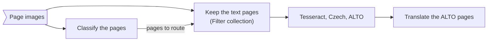

# ATRIUM Galaxy workflows

Four workflows for the ATRIUM page classifier and translator, as Galaxy `.ga` files (format-version 0.1). Import
each with *Workflows → Import* on any Galaxy that has the tools; on DARIAH's test instance
(<https://galaxy.acdh-dev.oeaw.ac.at/galaxy/>) they become usable once the two wrappers of `../tools/` are installed.

| Workflow                               | Input                 | Steps                                                                                                         | Main outputs                                            |
|----------------------------------------|-----------------------|---------------------------------------------------------------------------------------------------------------|---------------------------------------------------------|
| `ATRIUM_page_classification_images.ga` | a list of page images | page classification (one job for all pages)                                                                   | Top-N table, document records, text pages, paradata     |
| `ATRIUM_page_classification_pdfs.ga`   | a list of PDFs        | page classification, one job per PDF                                                                          | a Top-N table and a document record per PDF, paradata   |
| `ATRIUM_translate_xml.ga`              | a list of XML records | translation, one job per record (AMČR fields, cs→en, vocabulary)                                              | translated records, translation logs, records, paradata |
| `ATRIUM_classify_ocr_translate.ga`     | a list of page images | classification → keep the text pages → Tesseract (Czech, ALTO) → translation (ALTO, English beside the Czech) | Top-N table, ALTO pages, translated ALTO pages, logs    |

The chain:



**Name the page images `<document>-<page>`** (for example `report-0007`): the classifier reads the document and the
page number from each element's name. The text pages are those whose best category is `TEXT_P`, `TEXT_T` or
`TEXT`; change the classifier step's *Pages to route onward* to send others.

**Defaults** that the run form can change: model `v4.4` downloaded in the job (set *Model weights* to *Staged*
once the data manager has run), three categories per page; source language detected with Czech as the fallback,
English target, the bundled AMČR fields and vocabulary.

**Network.** The classifier's *Download* mode fetches its model from the Hugging Face Hub; the translator calls
the LINDAT translation and UDPipe services. Tesseract runs locally.

## Tests

```bash
planemo workflow_lint --iwc .
planemo test --galaxy_url <galaxy> --galaxy_user_key <key> ATRIUM_page_classification_images.ga
```

Each workflow has a `<name>-tests.yml` with data from `../tools/*/test-data/`. The tests run against a Galaxy that
has the tools installed (the tools' own tests are in `../tools/`).
