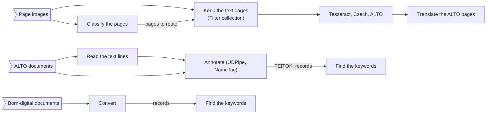

# ATRIUM Galaxy workflows (ÚFAL tools)

Six workflows for the ATRIUM tools wrapped in `../../tools/`, as Galaxy `.ga` files (format-version 0.1). Import each
with *Workflows → Import* on a Galaxy that has the tools; on DARIAH's test instance
(<https://galaxy.acdh-dev.oeaw.ac.at/galaxy/>) they become usable once the wrappers are installed. This folder sits
in `workflows/atrium_ufal/` of DARIAH-ERIC/atrium-galaxy-tools, beside DARIAH's own workflows.

| Workflow                               | Input                     | Steps                                                                                                         | Main outputs                                              |
|----------------------------------------|---------------------------|---------------------------------------------------------------------------------------------------------------|-----------------------------------------------------------|
| `ATRIUM_page_classification_images.ga` | a list of page images     | page classification (one job for all pages)                                                                   | Top-N table, document records, text pages, paradata       |
| `ATRIUM_page_classification_pdfs.ga`   | a list of PDFs            | page classification, one job per PDF                                                                          | a Top-N table and a document record per PDF, paradata     |
| `ATRIUM_translate_xml.ga`              | a list of XML records     | translation, one job per record (AMČR fields, cs→en, vocabulary)                                              | translated records, translation logs, records, paradata   |
| `ATRIUM_classify_ocr_translate.ga`     | a list of page images     | classification → keep the text pages → Tesseract (Czech, ALTO) → translation (ALTO, English beside the Czech) | Top-N table, ALTO pages, translated ALTO pages, logs      |
| `ATRIUM_ocr_nlp_keywords.ga`           | a list of ALTO documents  | OCR post-processing (text lines) → NLP enrichment (UDPipe, NameTag, TEITOK) → keyword extraction (YAKE)       | line tables, CoNLL-U, TEITOK, entities, keywords, records |
| `ATRIUM_born_digital_keywords.ga`      | a list of PDF, DOCX, XLSX | born-digital conversion → keyword extraction (YAKE)                                                           | Markdown, keywords, records with the `keywords` block     |

The scanned-pages chain and the text chain:



**Names.** The element names of the input lists become the document ids (and, for page images, `<document>-<page>`,
for example `report-0007`). In `ATRIUM_ocr_nlp_keywords` the line tables and the ALTO documents are paired by
position in their lists, and the keywords are matched to the records by element name; keep the names unique.

**One record per document.** Each stage takes the previous stage's ATRIUM document record and adds its blocks: in
`ATRIUM_ocr_nlp_keywords`, the record ends with the pages and text of OCR post-processing, the entities of NLP
enrichment and the keywords.

**Defaults** that the run form can change:

- classifier: model `v4.4` downloaded in the job (*Staged* once the data manager has run), three categories per
  page; text pages are `TEXT_P`, `TEXT_T` and `TEXT`;
- translator: source language detected with Czech as the fallback, English target, the bundled AMČR fields and
  vocabulary;
- keywords: YAKE, 20 per document, up to 3 words, Czech, per page too.

**Network.** The classifier's *Download* mode fetches its model from the Hugging Face Hub; the translator and NLP
enrichment call LINDAT (`lindat.mff.cuni.cz`). OCR post-processing, the born-digital converter, YAKE and Tesseract run
locally.

## Tests

```bash
planemo workflow_lint --iwc .
planemo test --galaxy_url <galaxy> --galaxy_user_key <key> ATRIUM_ocr_nlp_keywords.ga
```

Each workflow has a `<name>-tests.yml` with data from `../../tools/*/test-data/`. The tests run against a Galaxy that
has the tools installed (the tools' own tests are in `../../tools/`).
